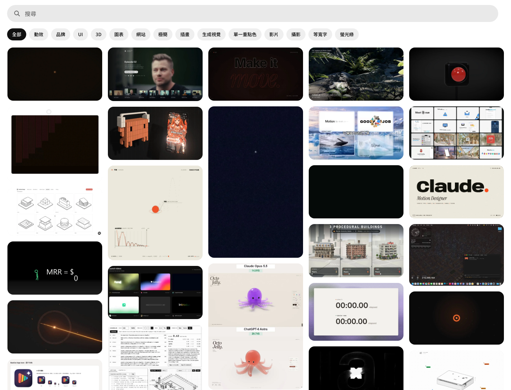
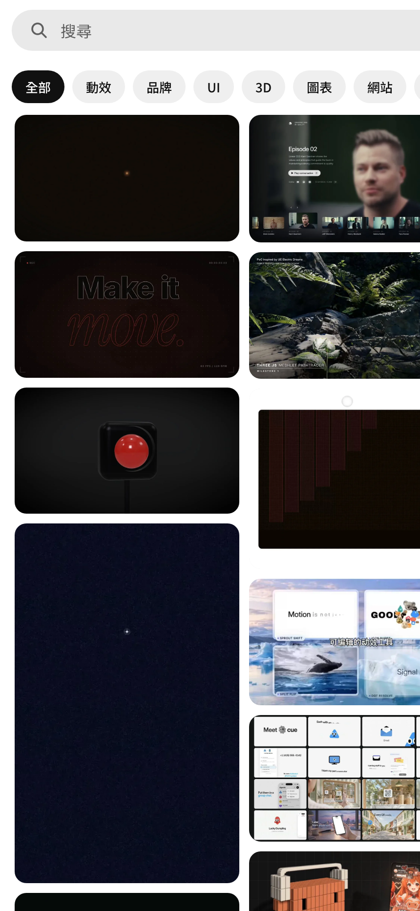
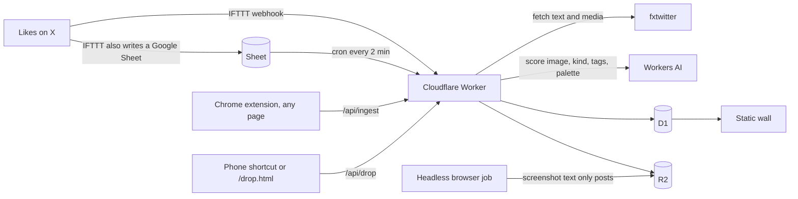

# Design Wall

A wall of the design work I liked on X, scored by a vision model and kept on one static page

[Live wall](https://hugo6991.github.io/design-wall/) · [Run it](#run-it) · [Make it yours](#make-it-yours)



The page you see is built from `data/cards.json`: 200 public posts I liked on X, picked by the score the intake model gave them. Every card links back to the original post and names the author. The pipeline that fills the wall by itself is in this repository too, but the wall runs without it

## Why I built this

I like a lot of design posts on X, and the likes tab is where they go to die. There is no search, no grouping, no way to see the last three months of taste in one glance. I wanted a wall I could scroll like a moodboard, with my own scoring on top, so the good ones would float up and the noise would sink

The second reason is that I design with agents. They need to see the same references I do, in a form they can read, so each card carries the author, the tags and a short note instead of just a picture. The wall became the shared memory for that work

Two things turned out harder than the wall itself. Most liked posts are text plus media, but a good number are text only, and a text only tweet has no image to score. So a small job renders the official embed in a headless browser, adds a row of counts under it and uploads that as the card. And the vision model that scores cards is a small one, because it runs on Workers AI for free, so it misses sometimes. A score here is a filter, not a verdict

## What it does


Open a card and you get the note, the tags, the palette the model pulled out and a link to the post



Two columns on a phone, search across titles and tags, and a hash in the URL so a card can be shared

## How it works



The Worker is the only piece that writes. It stores a row in D1 and the image in R2, asks Workers AI for a kind, a score and a palette, and keeps anything scored 6 or higher. A cron reads new Sheet rows every two minutes because IFTTT webhooks drop requests now and then, and the Sheet is the record that survives. Text only posts get rendered by `tools/x_shots.py` on a machine that is always on, since the embed needs a real browser

The wall itself is `site/`: one HTML file, one script, one stylesheet, no framework. `scripts/build.py` turns `data/cards.json` into `cards.js`, and that is the whole build

## Run it

```sh
git clone https://github.com/Hugo6991/design-wall.git
cd design-wall
python3 scripts/build.py
python3 -m http.server 8941
```

Open http://localhost:8941/site/ and you have the wall with the 200 cards. Python 3 is the only requirement for the static page

## Make it yours

### Just the wall, with your own cards

Edit `data/cards.json`. One card looks like this:

```json
{
  "id": "2101335516360647104",
  "title": "Interactive cards",
  "note": "Isometric illustration with hover motion",
  "tags": ["motion"],
  "date": "20260919",
  "author": "@kaolti",
  "url": "https://x.com/kaolti/status/2101335516360647104",
  "score": 10,
  "palette": ["#0b0b0f", "#f2f2f0"],
  "image": {"src": "assets/x/2101335516360647104.webp", "w": 1200, "h": 900}
}
```

Drop the image under `assets/x/`, run `python3 scripts/build.py --check` to catch missing fields, then `--dist` to get a `dist/` folder you can put on any static host. The included GitHub Actions workflow deploys `dist/` to GitHub Pages on every push to `main`

### The whole pipeline

You need a Cloudflare account with Workers, D1, R2 and Workers AI enabled

1. Copy `wrangler.example.jsonc` to `wrangler.jsonc`, then `npx wrangler d1 create design-wall-db` and `npx wrangler r2 bucket create design-wall-media`, and paste the D1 id into the config
2. `npx wrangler d1 execute design-wall-db --remote --file worker/schema.sql`
3. `npx wrangler secret put INGEST_TOKEN` with a long random string. Every write to the Worker needs this token
4. For X likes: an IFTTT applet "new liked tweet" that posts to `/api/x/ifttt` and also appends to a Google Sheet. Put the Sheet id in `X_LIKES_SHEET_ID` and share the Sheet as view only by link, because the cron reads it as CSV
5. `python3 scripts/build.py --dist && npx wrangler deploy`
6. Optional: load `extension/` as an unpacked Chrome extension after copying `config.example.js` to `config.js` with your Worker URL and token. Optional: run `tools/x_shots.py` on a schedule somewhere that stays on

The Worker scores with `@cf/zai-org/glm-5.3-flash` by default. Change `INTAKE_MODEL` in `wrangler.jsonc` if you want a different vision model, and edit `worker/prompt.js` if your taste differs from mine, which it should

## Data and privacy

| What | Where | In this repo |
| --- | --- | --- |
| 200 cards: post url, author handle, title, note, tags, score, palette | `data/cards.json` | Yes |
| Card images, resized to 1200px wide | `assets/x/` | Yes |
| My full likes export, the Sheet id, the D1 id, the ingest token | my private repo and Cloudflare | No |
| Your own cards and tokens once you fork | your `wrangler.jsonc` and `extension/config.js` | Ignored by git |

The cards are public posts. Each one links to the author and shows their handle. If you are the author of a card and want it removed, open an issue with the link and it comes out in the next sync

The private version of this project holds the complete pipeline state and my own notes. This repository is a filtered snapshot of it, synced by a script that replaces every personal identifier and scans the result before it is pushed

## Status

| Works today | Not here |
| --- | --- |
| Static wall, search, detail sheet, phone layout, Pages deploy | Accounts or multi user walls |
| Worker intake from likes, extension and phone, scoring, dedupe | A UI to manage cards without the token |
| Text only post screenshots with counts | Video playback on the public wall |

The interface text is Traditional Chinese for now

MIT License for the code and the build scripts. The card images belong to their authors

Built by one person with a team of agents. Product and design decisions are mine; agents write the code and I review what ships
