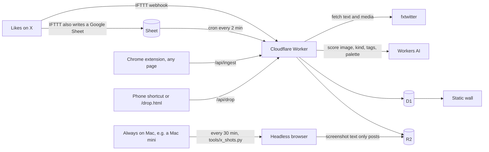

# Design Wall

A wall of the design work I liked on X, scored by a vision model and kept on one static page

[Live wall](https://hugo6991.github.io/design-wall/) · [Run it](#run-it) · [Set it up with an agent](#set-it-up-with-an-agent) · [Make it yours](#make-it-yours)


The page you see is built from `data/cards.json`: 200 public posts I liked on X, picked by the score the intake model gave them. Every card links back to the original post and names the author. The pipeline that fills the wall by itself is in this repository too, but the wall runs without it

## Why I built this

I like a lot of design posts on X, and the likes tab is where they go to die. There is no search, no grouping, no way to see the last three months of taste in one glance. I wanted a wall I could scroll like a moodboard, with my own scoring on top, so the good ones would float up and the noise would sink

The second reason is that I design with agents. They need to see the same references I do, in a form they can read, so each card carries the author, the tags and a short note instead of just a picture. The wall became the shared memory for that work

Two things turned out harder than the wall itself. Most liked posts are text plus media, but a good number are text only, and a text only tweet has no image to score. So a small job renders the official embed in a headless browser, adds a row of counts under it and uploads that as the card. And the vision model that scores cards is a small one, because it runs on Workers AI for free, so it misses sometimes. A score here is a filter, not a verdict

## What it does


Open a card and you get the note, the tags, the palette the model pulled out and a link to the post


Two columns on a phone, search across titles and tags, and a hash in the URL so a card can be shared

## How it works



The Worker is the only piece that writes. It stores a row in D1 and the image in R2, asks Workers AI for a kind, a score and a palette, and keeps anything scored 6 or higher. A cron reads new Sheet rows every two minutes because IFTTT webhooks drop requests now and then, and the Sheet is the record that survives. Text only posts get rendered by `tools/x_shots.py` on a machine that is always on, since the embed needs a real browser

The wall itself is `site/`: one HTML file, one script, one stylesheet, no framework. `scripts/build.py` turns `data/cards.json` into `cards.js`, and that is the whole build

## What you need

| For | You need |
| --- | --- |
| The static wall | Python 3, nothing else |
| Likes flowing in by themselves | A Cloudflare account with Workers, D1, R2 and Workers AI, an IFTTT account, a Google Sheet |
| Text only posts showing up as cards | A second machine that never sleeps, I use a Mac mini |

The last row is the one people miss. The Sheet itself is read by a Cloudflare cron, so likes keep landing on the wall with every laptop closed. But a liked post with no image or video has nothing to score until `tools/x_shots.py` opens the official embed in Chromium and takes a picture of it, and that needs a real browser running somewhere. A laptop that sleeps works badly here: the queue piles up overnight and the cards show up hours late. I run it on a Mac mini under launchd every 30 minutes. Any always on Mac or Linux box with Python and Playwright will do

Without that machine the pipeline still works. Posts with media go up as usual, and text only posts wait in the queue until something renders them

## Run it

```sh
git clone https://github.com/Hugo6991/design-wall.git
cd design-wall
python3 scripts/build.py
python3 -m http.server 8941
```

Open http://localhost:8941/site/ and you have the wall with the 200 cards. Python 3 is the only requirement for the static page

## Set it up with an agent

Paste one of these into Claude Code, Codex or any coding agent that can run a shell. The agent asks you the questions first, because a few steps need your own accounts and only you can do them, then it builds the parts you chose and tells you exactly what is left for you

### English

```text
Set up my own copy of https://github.com/Hugo6991/design-wall

Before you change anything, ask me these and wait for my answers:
1. Which version do I want: just the static wall with my own cards, or the full pipeline that fills it from my X likes?
2. Where do my cards come from: a folder of images I already have, a list of links, or my X likes?
3. Where should it live: GitHub Pages (free, static only) or Cloudflare (needed for the pipeline)?
4. If the pipeline: do I already have a Cloudflare account with Workers, D1, R2 and Workers AI, and am I logged in with `npx wrangler login`?
5. If X likes: am I fine making an IFTTT applet "new liked tweet" that posts to the Worker and also writes a Google Sheet shared view only by link?
6. What should the scorer care about? Give me 3 to 5 lines about my taste for `worker/prompt.js`, or keep the default
7. Interface language: keep Traditional Chinese, or switch the visible text to English?

Then:
- Fork or clone the repo, run `python3 scripts/build.py --check`, and show me the wall at http://localhost:8941/site/
- For my own cards, write them into `data/cards.json` with the images under `assets/x/`, and run `--check` again until it passes
- For the pipeline, follow "The whole pipeline" in the README. Never print or commit `INGEST_TOKEN`, the D1 id or the Sheet id; they go in `wrangler.jsonc`, `extension/config.js` or `wrangler secret put`, which git ignores
- Stop and hand me a numbered list for anything that needs my login or a click: Cloudflare login, the IFTTT applet, sharing the Sheet, loading the Chrome extension
- At the end, tell me the live URL, what you checked and what you did not
```

### 繁體中文

```text
幫我建一份自己的 https://github.com/Hugo6991/design-wall

動手前先問我下面這些，等我回答再開始
1. 要哪個版本？只要靜態的牆、放我自己的卡片，還是要從 X 按讚自動收進來的完整流程？
2. 卡片從哪來？我手上已有的一批圖、一串連結，還是我的 X 按讚？
3. 放在哪裡？GitHub Pages（免費，只有靜態頁）還是 Cloudflare（完整流程一定要）？
4. 要完整流程的話，我有沒有開好 Workers、D1、R2、Workers AI 的 Cloudflare 帳號，有沒有跑過 `npx wrangler login`？
5. 要收 X 按讚的話，我願不願意開一個 IFTTT「按讚新推文」的 applet，同時送到 Worker、也寫進一張「知道連結就能檢視」的 Google 試算表？
6. 打分要看什麼？給我 3 到 5 行我的品味寫進 `worker/prompt.js`，或者沿用預設
7. 介面文字要留繁體中文，還是改成英文？

我回答完之後
- Fork 或 clone 這個 repo，跑 `python3 scripts/build.py --check`，在 http://localhost:8941/site/ 給我看牆
- 放我自己的卡片時，寫進 `data/cards.json`，圖放 `assets/x/`，再跑 `--check` 直到通過
- 要完整流程就照 README 的「The whole pipeline」做。`INGEST_TOKEN`、D1 id、試算表 id 不准印出來、不准 commit，只放在 git 會忽略的 `wrangler.jsonc`、`extension/config.js` 或 `wrangler secret put`
- 遇到要我登入或點按的地方就停，給我一張編號清單：Cloudflare 登入、IFTTT applet、分享試算表、載入 Chrome 擴充功能
- 最後告訴我線上網址、你驗證過什麼、什麼還沒驗證
```

## Make it yours

### Just the wall, with your own cards

Edit `data/cards.json`. One card looks like this:

```json
{
  "id": "2101335516360647104",
  "title": "Interactive cards",
  "note": "Isometric illustration with hover motion",
  "tags": ["motion"],
  "date": "20260919",
  "author": "@kaolti",
  "url": "https://x.com/kaolti/status/2101335516360647104",
  "score": 10,
  "palette": ["#0b0b0f", "#f2f2f0"],
  "image": {"src": "assets/x/2101335516360647104.webp", "w": 1200, "h": 900}
}
```

Drop the image under `assets/x/`, run `python3 scripts/build.py --check` to catch missing fields, then `--dist` to get a `dist/` folder you can put on any static host. The included GitHub Actions workflow deploys `dist/` to GitHub Pages on every push to `main`

### The whole pipeline

You need a Cloudflare account with Workers, D1, R2 and Workers AI enabled

1. Copy `wrangler.example.jsonc` to `wrangler.jsonc`, then `npx wrangler d1 create design-wall-db` and `npx wrangler r2 bucket create design-wall-media`, and paste the D1 id into the config
2. `npx wrangler d1 execute design-wall-db --remote --file worker/schema.sql`
3. `npx wrangler secret put INGEST_TOKEN` with a long random string. Every write to the Worker needs this token
4. For X likes: an IFTTT applet "new liked tweet" that posts to `/api/x/ifttt` and also appends to a Google Sheet. Put the Sheet id in `X_LIKES_SHEET_ID` and share the Sheet as view only by link, because the cron reads it as CSV
5. `python3 scripts/build.py --dist && npx wrangler deploy`
6. Optional: load `extension/` as an unpacked Chrome extension after copying `config.example.js` to `config.js` with your Worker URL and token. Optional: the screenshot job below
7. On the always on machine: `python3 -m venv ~/.design-wall/venv`, then `~/.design-wall/venv/bin/pip install playwright pillow` and `~/.design-wall/venv/bin/playwright install chromium`. Copy `tools/x_shots.py` to `~/.design-wall/`, set `API` at the top to your Worker URL, and put the same `INGEST_TOKEN` in `~/.design-wall/ingest-token`. Run it once by hand with `--dry-run` to see the queue
8. On a Mac, copy `tools/ai.designwall.x-shots.plist` to `~/Library/LaunchAgents/`, replace `YOUR_USER` with your user name, and `launchctl load` it. It runs every 30 minutes and logs to `~/.design-wall/shots.log` and `shots.err`. On Linux a cron line with the same command does the same job. `/api/x/status` on the Worker shows `shots.at`, the last time the job checked in; more than an hour old means the machine is asleep or the job is failing

The Worker scores with `@cf/zai-org/glm-5.3-flash` by default. Change `INTAKE_MODEL` in `wrangler.jsonc` if you want a different vision model, and edit `worker/prompt.js` if your taste differs from mine, which it should

## Data and privacy

| What | Where | In this repo |
| --- | --- | --- |
| 200 cards: post url, author handle, title, note, tags, score, palette | `data/cards.json` | Yes |
| Card images, resized to 1200px wide | `assets/x/` | Yes |
| My full likes export, the Sheet id, the D1 id, the ingest token | my private repo and Cloudflare | No |
| Your own cards and tokens once you fork | your `wrangler.jsonc` and `extension/config.js` | Ignored by git |

The cards are public posts. Each one links to the author and shows their handle. If you are the author of a card and want it removed, open an issue with the link and it comes out in the next sync

The private version of this project holds the complete pipeline state and my own notes. This repository is a filtered snapshot of it, synced by a script that replaces every personal identifier and scans the result before it is pushed

## Status

| Works today | Not here |
| --- | --- |
| Static wall, search, detail sheet, phone layout, Pages deploy | Accounts or multi user walls |
| Worker intake from likes, extension and phone, scoring, dedupe | A UI to manage cards without the token |
| Text only post screenshots with counts | Video playback on the public wall |

The interface text is Traditional Chinese for now

MIT License for the code and the build scripts. The card images belong to their authors

Built by one person with a team of agents. Product and design decisions are mine; agents write the code and I review what ships
